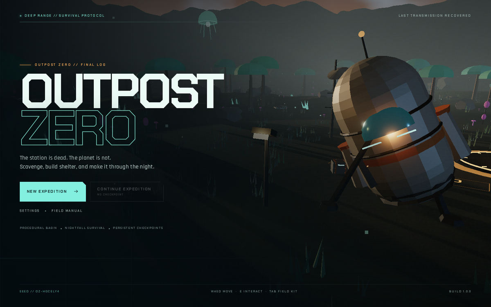
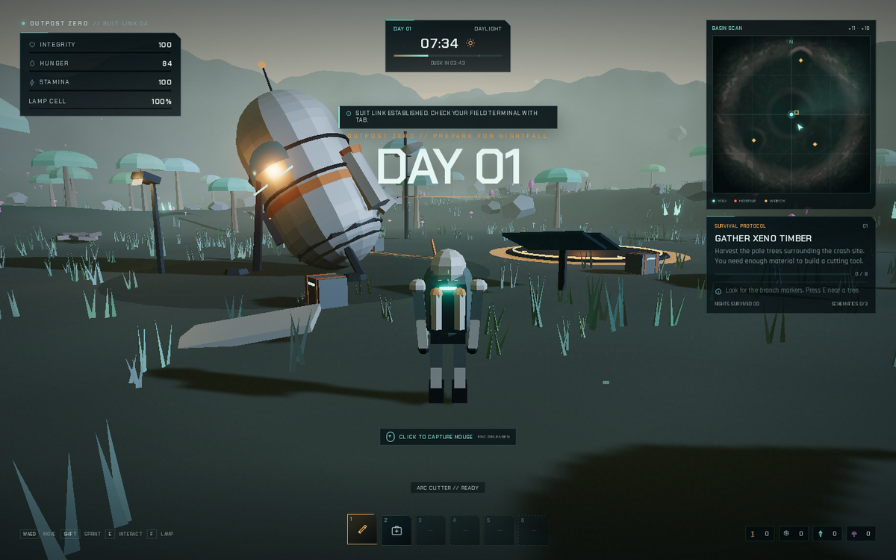
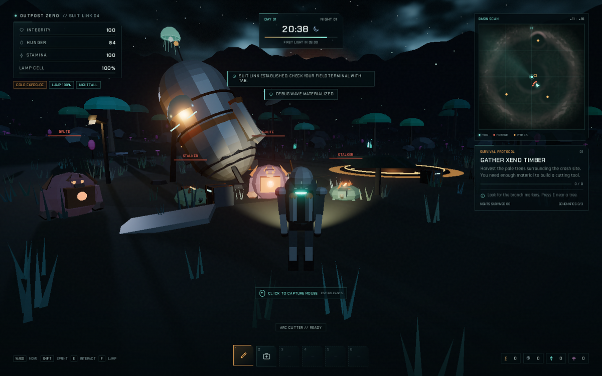
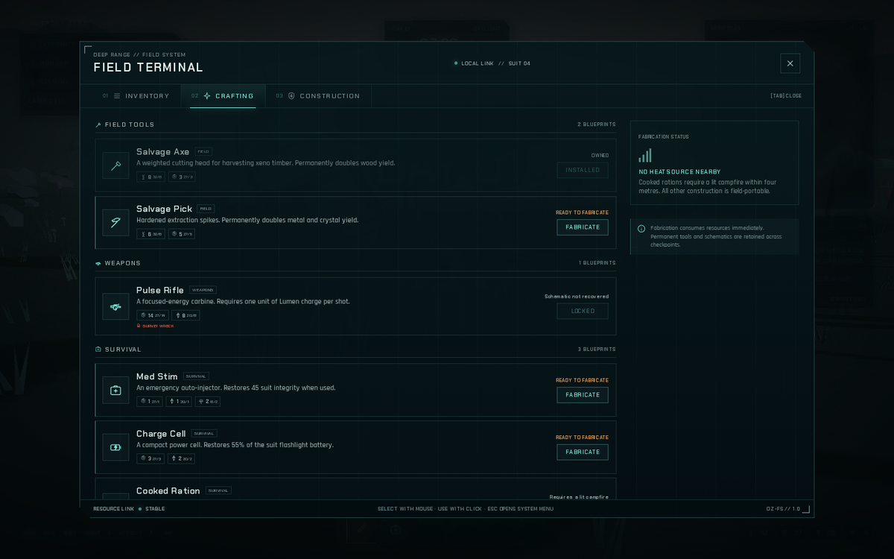
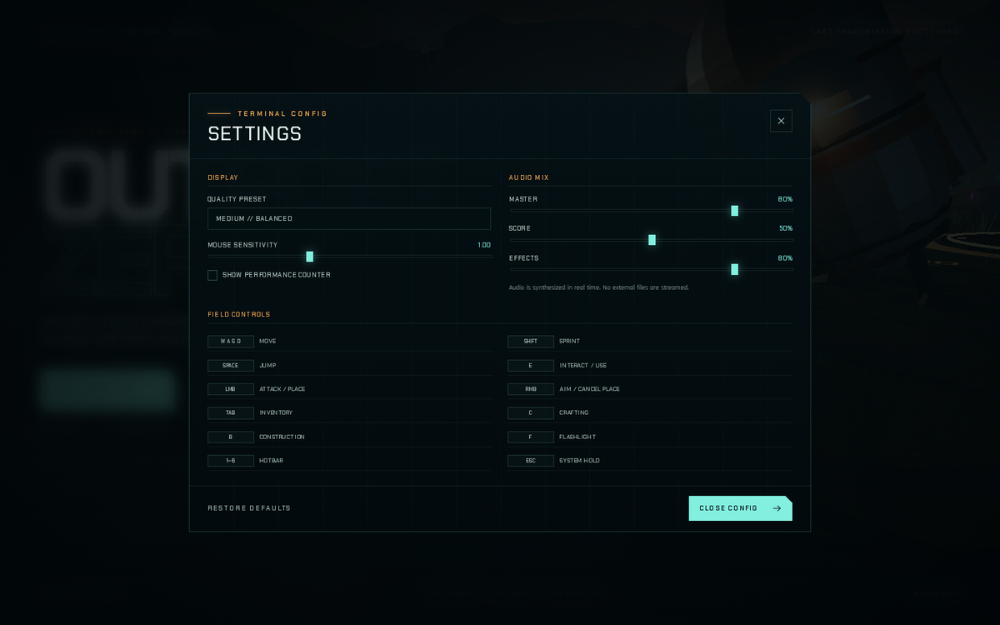

# OUTPOST ZERO

**A stylized 3D alien survival game that runs entirely in the browser.**

[](https://github.com/emilio-n8n/outpost-zero/actions/workflows/ci.yml)
[](https://emilio-n8n.github.io/outpost-zero/)

The last survivor of a deep-range research station wakes beside a crashed lander on an
unfamiliar world. Scavenge the basin, recover the schematics lost in three wreck sites, build
a warm shelter, and hold the landing pad long enough for rescue to lock on.



## Play

**[Launch OUTPOST ZERO on GitHub Pages →](https://emilio-n8n.github.io/outpost-zero/)**

Desktop browser with WebGL2, mouse and keyboard recommended. Click the game view once to
capture the mouse. Audio is synthesized on the fly and starts after your first interaction.

## What is in the game

- **A complete expedition, not an endless demo.** Recover the beacon schematic, build the
  signal beacon on the outpost pad, activate the uplink, and survive the 80-second final siege.
- **A seeded procedural basin.** Terrain, forests, crystal ridges, scrap fields, ruins,
  resource placement and the minimap are generated from a run seed. A ring of mountains and
  atmospheric fog frame the playable area.
- **A real survival loop.** Health, hunger, stamina and flashlight charge. Deep-night cold
  drains suit integrity unless you are close to a lit campfire or your shelter core. Food and
  med stims restore what the night takes away.
- **Three hostile species and escalating nights.** Stalkers hunt in packs, brutes break
  barricades, spitters fire acid from range. Each night adds more pressure; the final siege
  brings a Warden.
- **Tools, weapons and equipment.** Salvage an axe and pick for better yields, fabricate a
  pulse rifle that spends Lumen charge, med stims, charge cells and cooked rations.
- **Blueprint-driven progression.** The Survey, Freighter and Relay wrecks hold the rifle,
  turret and signal-beacon schematics. Exploration is the progression system.
- **Placeable construction.** Campfires, barricades, heated shelters, Tesla turrets and the
  signal beacon. Construction has a ghost preview, grid snapping, collision validation,
  resource costs and destructible health.
- **A warm bowl of light in a very dark place.** Campfires and shelters give warmth, cooking
  and a respawn point. Fires burn down and can be refuelled with timber.
- **Persistence.** Manual checkpoints, autosaves at dawn/dusk and every minute, world deltas,
  inventory, constructed structures, looted caches and respawn timers are stored in
  `localStorage` under `outpost-zero:save:v1`.
- **A fully synthesized soundscape.** Procedural wind, wildlife, fire, footsteps, combat and an
  adaptive day/night score. No audio files are downloaded.
- **A designed interface.** A field-terminal inventory/crafting/construction screen, hotbar,
  minimap, objective tracker, vitals, damage feedback, settings, pause menu, death screen and
  extraction screen.

## Screens

| Daylight | Nightfall |
| --- | --- |
|  |  |

| Field terminal | Settings |
| --- | --- |
|  |  |

## Controls

| Input | Action |
| --- | --- |
| `W A S D` | Move |
| Mouse | Look (capture with a click) |
| `Shift` | Sprint |
| `Space` | Jump |
| `E` | Interact / harvest / refuel / salvage |
| `Left Mouse` | Attack, use the selected consumable, or place a structure |
| `Right Mouse` | Aim the rifle / cancel construction |
| `1` – `6` | Select hotbar slot |
| `F` | Toggle flashlight |
| `Tab` or `I` | Field terminal: inventory |
| `C` | Field terminal: crafting |
| `B` | Field terminal: construction |
| `R` | Rotate a build preview |
| `Esc` | Pause / close terminal / cancel preview |

The **Field Manual** on the title and pause screens contains a compact survival guide.

## A short survival primer

1. Gather **Xeno Timber** from the pale trees around the basin edge. Metal, Lumen crystals and
   biomass grow in different parts of the basin.
2. Craft the **Salvage Axe** (and later **Salvage Pick**) to double wood and mineral yields.
3. Build a **Campfire** before dusk. Night cold is lethal away from warmth.
4. Explore the **Survey Wreck** first; its data core unlocks the pulse rifle.
5. Build the **Shelter Core** for a warm respawn point.
6. Find the **Relay Wreck** schematic, craft the **Signal Beacon**, and install it on the
   outpost landing pad.
7. Activate the uplink and hold the pad. The uplink only advances while you are near it.

## Architecture

Plain **TypeScript + Three.js + Vite**, with a DOM-based UI layered over the WebGL canvas.
No React runtime and no external art or audio assets.

```text
src/
  core/          deterministic RNG, value noise, input, storage, settings
  world/         seeded terrain, sky, aurora, landmarks, scatter, resources,
                 structures, build preview, world collision, alien drifters
  player/        third-person controller, procedural suit model, camera rig
  enemies/       creature models, AI, projectiles and spawn management
  game/          orchestration, survival, crafting data, inventory, objectives,
                 day/night, night director, saves, synthesized audio
  ui/            HUD, field terminal, minimap, menus, icons, onboarding
  audio/         WebAudio synthesis and adaptive score
  fx/            pooled particles, tracers and impact effects
tests/           Vitest unit coverage of pure systems
e2e/             Playwright browser flows and 1440×900 screenshot capture
```

The gameplay systems are separated from rendering wherever practical. World generation is
seeded so a save only has to store the seed, the player delta and the world changes.

## Development

Requirements: **Node 22+**.

```bash
npm ci
npm run dev        # Vite dev server
npm run typecheck  # strict TypeScript
npm run test       # Vitest unit tests
npm run build      # production bundle in dist/
npm run test:e2e   # Playwright flows (expects a built dist/ and preview)
```

The checked-in lockfile and pinned dependencies are used by CI.

## Validation

Every push to `main` runs the **Validate & Deploy** workflow on GitHub-hosted runners:

1. `npm ci` with npm caching
2. strict `tsc --noEmit`
3. Vitest unit tests
4. Vite production build
5. Playwright (Chromium + SwiftShader WebGL) covering title → new run → movement →
   inventory/crafting → save → reload → continue, harvesting and tool crafting, deterministic
   construction, enemy damage, settings, field manual, death/respawn and extraction screens
6. Uploaded screenshot evidence from the browser run
7. GitHub Pages deployment only after all checks pass

This project was developed against the CI pipeline rather than local builds or test runs.

## Save data and compatibility

Saves are versioned and validated on load. Incompatible, truncated or unavailable storage is
handled gracefully; the title screen simply disables **Continue**. Delete
`outpost-zero:save:v1` in your browser's local storage to reset the checkpoint.

## Performance

Quality presets are available in **Settings**: Low (no post-processing or shadows, 1× pixel
ratio), Medium (default), and High. The world uses instanced foliage and resources, pooled
particles, capped dynamic lights, a shadow camera around the player, and figure/character
geometry shared between entities. If you are on a low-powered machine, choose **Low** before
starting a run.

## Credits

Built with [Three.js](https://threejs.org/), Vite and TypeScript. Typefaces: Chakra Petch and
Rajdhani, bundled through Fontsource. Every mesh, material, texture, world layout, creature,
weapon and sound in the game is generated procedurally for this project.

## License

MIT. See [LICENSE](LICENSE).
